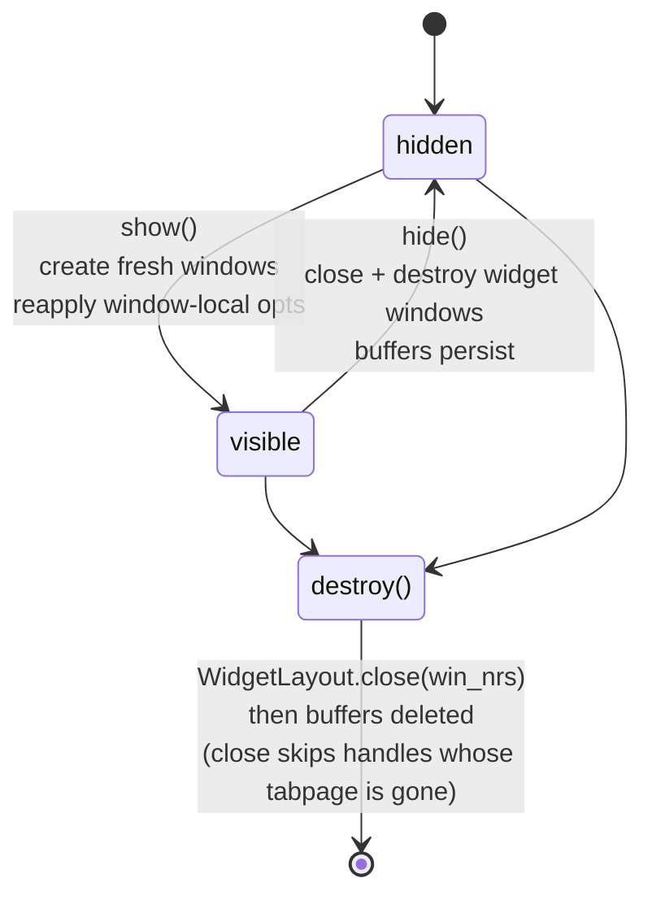

# ChatWidget lifecycle

Widget windows are disposable. Buffers persist; windows do not.

## State machine

Each transition cites the test that pins it. A transition without a test is a
gap: add the test or delete the transition.

Pinned by, in `lua/agentic/ui/chat_widget.test.lua`:

- `hidden -> visible`: `::"show() after hide() creates new windows"`,
  `::"show() is idempotent when called multiple times"`
- `visible -> hidden`: `::"hide() closes all windows and preserves buffers"`,
  `::"hide() is safe when called multiple times"`
- `hidden -> destroy`: `::"deletes the buffers of a hidden widget without raising"`
- `visible -> destroy`:
  `::"keeps the tabpage alive when the widget holds its only windows"`
- hidden float on `destroy`: `::"tears down the hidden chat window on destroy"`

## Rules

- `show` after `hide` creates fresh windows and applies every window-local
  option. `show` on a visible widget reuses its live windows; it reopens
  nothing.
- Before closing widget windows, `hide` ensures a non-widget fallback window
  exists in the same tabpage; if `has_non_agentic_window` returns false it
  calls `open_editor_window` (except `stacked`, below). Skipping this destroys
  the user's tabpage: closing the last window of a non-current tabpage closes
  that tabpage silently, and E444 (cannot close last window) only fires when it
  is also the last tabpage. See `ChatWidget:hide`.
- `open_editor_window` puts the first readable oldfile under the cwd in the
  window it opens, else a new scratch buffer. In every position but `stacked`,
  that is what a widget-only tab falls back to.
- A `stacked` widget that is alone in its tab falls back to an empty marked
  scratch window, and the next `stacked` show reclaims it while it is
  untouched. `ChatWidget:_open_fallback_scratch` marks it with
  `vim.w[winid].agentic_fallback_bufnr`, and `ChatWidget:_reclaim_fallback_windows`
  runs only on a `show` that opened the widget's windows from a hidden state,
  never on `rerender` or a `show` that reused visible windows. Reclaiming on
  every `show` closes a fallback the user is looking at while the widget
  re-renders. A window qualifies only while it still shows the marked buffer,
  unnamed, unmodified and a single empty line; without the marker check the
  reclaim closes the user's own empty `:tabnew` window. Regressions:
  `chat_widget.test.lua::"leaves an empty marked scratch when a stacked widget hides"`,
  `::"reclaims the untouched scratch when a stacked widget shows"`,
  `::"keeps a scratch the user typed into"`,
  `::"keeps a scratch whose window shows another buffer"`,
  `::"leaves a marked window alone on rerender"`,
  `::"leaves an empty marked scratch when a stacked widget is destroyed from another tab"`,
  `::"keeps the oldfile fallback for a side layout"` and
  `tests/integration/test_multi_session.lua::"keeps a widget-only stacked tab widget-only across a switch"`.
- `SessionRegistry` replacement (`/new`, provider switch, restore, reattach)
  requires a non-widget anchor: it shows the target inside `nvim_win_call` on
  `find_first_non_widget_window` in the source's tabpage. A visible source with
  no such window rolls the replacement back and destroys the target. A
  `stacked` source supplies a reclaimable fallback instead:
  `ChatWidget:ensure_fallback_window` opens the marked scratch, and the
  target's `show` reclaims it from inside that `nvim_win_call`, so the tab stays
  widget-only. The public wrapper creates the scratch whenever
  `find_first_non_widget_window` finds nothing; `_ensure_fallback_window` would
  skip it beside a quickfix or help window, which keeps the tab alive but is no
  anchor. Regressions:
  `session_registry.test.lua::"rolls back when a visible source has no usable anchor"`,
  `::"commits a replacement into the same tab"`,
  `::"commits beside a quickfix window"` and
  `::"still rolls back a side layout"`.
- Replacement focus: the window that was current when the replacement started
  is usually a source widget window, and it closes inside the `nvim_win_call`.
  `nvim_win_call` then returns to a window chosen by the order the source's
  windows closed. `WidgetLayout.close` walks `win_nrs` with `pairs`, and
  LuaJIT randomizes that order per process, so the landing window can be the
  source's hidden chat float, which the user cannot leave by window
  navigation. After the placement, `commit_replacement` moves focus to the
  target's input window, else its chat, in the current tabpage, whenever the
  current window is unusable, floating, hidden or unfocusable. A normal window
  keeps focus, so a side-layout replacement started from an editor window stays
  there. Regressions:
  `session_registry.test.lua::"focuses the target's input after a replacement from the source's input, retain_source false"`,
  `::"focuses the target's input after a replacement from the source's input, retain_source true"`
  and `::"keeps focus in the editor window for a side layout"`. The first two
  fix the close order with a `WidgetLayout.close` stub that closes `input`
  last; without it they fail only in some processes.
- A caller that reaches `hide` across an async boundary MUST pass the tabpage it
  captured BEFORE the defer, as `hide(keep_insert, tabpage)`. `WinClosed` fires on
  `win_nrs.chat` and invalidates it before the scheduled `hide` runs, and
  `get_visible_tab_id` reads no other handle, so the derived placement is already
  nil there: `_ensure_fallback_window` returns early and the close takes the
  widget-only tabpage down with it. Only the tabpage IDENTITY crosses the boundary
  — `_ensure_fallback_window` and `has_non_agentic_window` still re-check
  `nvim_tabpage_is_valid` on it. Regression:
  `chat_widget.test.lua::"keeps a widget-only tab alive when the chat window closes"`.
- `ChatWidget:open_editor_window` anchors on the first USABLE window in
  `win_nrs`, preferring chat. The chat handle is already dead on the `WinClosed`
  path above, and returning nil there is what loses the tabpage.
- Programmatic window closes (`hide`, layout rotation) MUST wrap the close call
  in `ChatWidget:_avoid_auto_close_cmd`. The wrapper sets `self._closing = true`
  so the `WinClosed` autocmd's auto-close-on-user-close branch skips the call.
  Skipping the wrapper triggers a recursive close through the autocmd. Tests:
  `chat_widget.test.lua` group `"WinClosed autocmd"`.
- `destroy` never routes through `hide`, but both share
  `ChatWidget:_ensure_fallback_window`. It calls that, then `WidgetLayout.close`
  on its `win_nrs`, then deletes the buffers. Relative to `hide` it skips
  hidden-float recreation, size capture, and `stopinsert` suppression — a
  destroyed widget is never shown again. `WidgetLayout.close` skips every handle
  whose tabpage is already gone, keeping this safe during a tabclose teardown on
  0.11.x. See `ChatWidget:destroy`.
  - The fallback is mandatory here. `SessionRegistry.show_session` hides
    non-target widgets in the current tabpage and hides the target at its previous
    placement, so an outgoing session in another tabpage stays visible. Destroying
    it reaches `WidgetLayout.close` there, and without the fallback that tabpage
    disappears under the user. Reachable from `Agentic.destroy_session` and from
    restore's explicit `Destroy current session` choice. Regression:
    `chat_widget.test.lua::"keeps the tabpage alive when the widget holds its only windows"`.
  - **Ordering: the fallback MUST run before `WidgetRegistry.unregister`.**
    `has_non_agentic_window` excludes windows showing a registered widget
    buffer, so once unregistered the widget's own chat window looks like a valid
    fallback and gets handed back.
- `destroy` is the one programmatic close exempt from the
  `_avoid_auto_close_cmd` rule above. It deletes the
  `AgenticWinClosed_<chat bufnr>` augroup before closing, so the only listener
  that ever read `self._closing` is gone by then; setting the flag would guard
  nothing. Any new close path that runs while that augroup still exists MUST
  wrap.

## Widget buffers and windows

- Widget buffers are `buflisted = false` and `buftype = nofile`. Each widget
  window records its buffer in `vim.w[winid].agentic_bufnr`, 1:1. Users cannot
  swap buffers between widget windows; `BufferGuard` restores them.
- The `WinClosed` autocmd hides the WHOLE widget when the user closes any one
  widget window. The widget is one unit.

## Background sessions

A **background session** must never be surfaced by a content callback. The
`FileList`, `CodeSelection`, `DiagnosticsList` and `TodoList` `on_change`
handlers call `ChatWidget:rerender`, which no-ops when `get_visible_tab_id()` is
nil. Calling `show` directly there put a second widget in the current tabpage —
a `plan` update from a hidden session was enough, with no user action at all.
The update survives: panel buffers are written before `on_change` fires, and
`show_layout` decides each panel window from buffer emptiness at show time.
Regression:
`tests/integration/test_multi_session.lua::"keeps a hidden session hidden when its file list changes"`.

- **An EMPTY panel is the same path and MUST obey the same two rules.** The
  existing regression covers a non-empty panel only, and the empty case takes a
  different branch: `open_or_resize_dynamic_window` closes the panel window
  instead of opening one. That close runs asynchronously, so the cached handle
  can belong to a tabpage the user has since closed — stale-valid on 0.11.x,
  hence `BufHelpers.is_win_usable`, not bare validity — and closing it MUST NOT
  move the cursor out of the tab the user is looking at. Regression:
  `lua/agentic/ui/widget_layout.test.lua::"clears an empty panel whose tabpage is gone"`.
- A cached panel handle from ANOTHER tabpage MUST NOT be reused, and MUST be
  closed when the panel is reopened. Chat and input enforced this; dynamic
  panels did not, so a widget that moved tabpages left its panels behind and
  split one widget's topology across two tabs, the abandoned window untracked
  once `win_nrs` was repointed. Regression:
  `lua/agentic/ui/widget_layout.test.lua::"creates a fresh chat window when the cached one is in another tab"`.

## Hidden chat float

A hidden chat floating window keeps the chat buffer attached while the widget
is hidden, so manual folds can be applied while closed. See ADR 0001. Tests:
`chat_widget.test.lua` group `"hidden chat window lifecycle"`.

- Opened with `hide = true` + `focusable = false` + `noautocmd = true`. The user
  cannot reach it: `<C-w>w`/`<C-w>p`, `:wincmd`, and `:buffer` skip it;
  `nvim_list_wins()` returns it but interactive navigation does not visit it.
  Only code holding `widget._hidden_chat_winid` can target it (via
  `nvim_set_current_win`/`nvim_win_set_buf`). Treat it as an internal handle,
  not a window the user might be sitting in. Do NOT add keymaps, buffer-local
  autocmds expecting user focus, or any UX that assumes the user can act inside
  it.
- Reopening the hidden chat float without closing the previous one overwrites
  the stored winid and leaks the prior window. Regression:
  `chat_widget.test.lua::"does not leak a hidden float across hide() calls"`.
